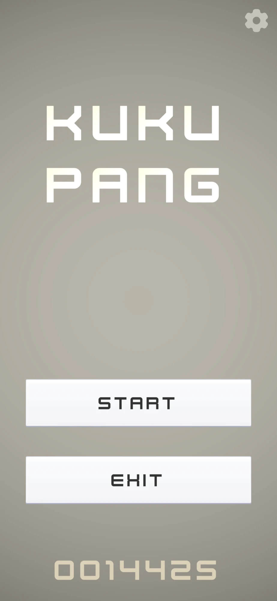
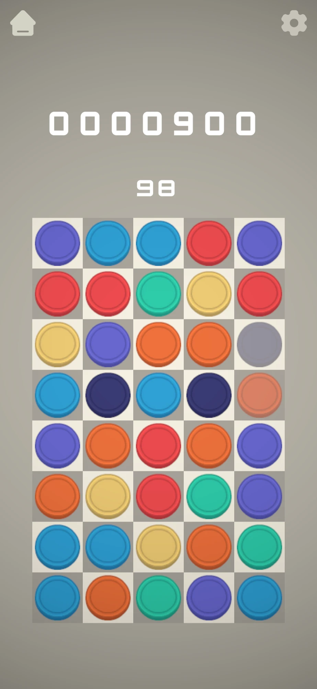
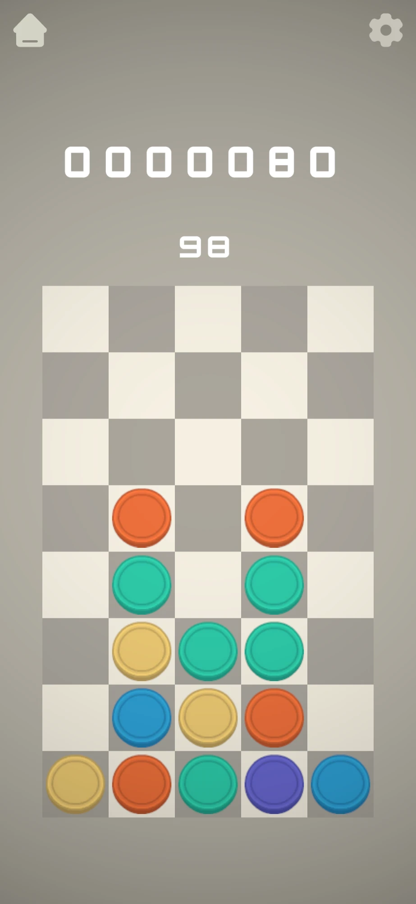

# 3Match

> 📌 같은 색의 과일을 3개 이상 맞춰 없애는 모바일 3매치 퍼즐 게임입니다. 제한된 이동 횟수 안에 최대한 높은 점수를 얻는 것이 목표입니다.





🔗 [문서](https://abaft-yarn-52enotionsiteKukuPang-247c32f2552880ddab12c5a2c0570950?pvs=74)

---

## 📂 폴더 구조

```
Assets/
├── 01.Script/
│   ├── Board.cs           # 스왑 · 매치 · 중력 · 리필 흐름 제어
│   ├── MatchChecker.cs    # 가로 · 세로 · 사각형 매치 판정, 힌트 탐색
│   ├── TileController.cs  # 타일 생성 · 인접 판정
│   ├── ItemController.cs  # 과일 생성 · 리필 · 리롤
│   ├── BoardInput.cs      # 마우스 · 터치 입력
│   ├── Item/              # 특수 아이템
│   ├── Audio/             # 효과음 · BGM
│   ├── UI/                # 팝업 · 버튼 · 점수
│   └── Utils/             # 싱글톤, UniqueQueue
└── Resources/Editor/      # 레벨 에디터 툴
```

---

## 🔹 핵심 구조

### 보드 · 매치 — `Board.cs`, `MatchChecker.cs`
- `Board`가 입력 → 스왑 → 매치 판정 → 제거 → 중력 → 리필 → 연쇄 매치까지의 흐름을 중앙에서 제어합니다.
- 타일은 `TileController`, 과일은 `ItemController`, 입력은 `BoardInput`으로 역할을 분리했습니다.
- `MatchChecker`는 기준 타일 주변의 가로 · 세로 3칸과 2x2 사각형을 검사하고, 매치가 없으면 스왑을 되돌립니다.
- 스왑을 시뮬레이션해 가능한 수를 찾아 일정 시간 매치가 없으면 힌트로 표시하고, 가능한 수가 없으면 보드를 다시 섞습니다.
- 매치 대상 타일은 중복 없는 큐 `UniqueQueue<T>`로 관리합니다.

### 아이템 — `Item/`
- `ItemHandler`가 매치 모양을 분석해 플레이어가 움직인 위치에 특수 아이템을 생성합니다.
- 아이템이 매치에 포함되면 해당 행 또는 열 전체를 제거하고 `ItemEffect`로 이펙트를 출력합니다.

### 레벨 에디터 — `Resources/Editor/`
- 레벨은 `LevelData`(ScriptableObject)에 보드 크기와 칸별 색상으로 저장하고, `LevelDataContainer`에서 무작위로 불러옵니다.
- `LevelEditorWindow`(IMGUI)는 그리드를 클릭해 색을 칠하고, `TextLevelEditor`(UI Toolkit)는 `R`, `G`, `B` 같은 문자로 레벨을 작성해 에셋과 양방향으로 변환합니다.

### UI · 사운드 — `UI/`, `Audio/`
- 매니저는 `MonoSingleton<T>`과 `[DontDestroyOnLoad]` 어트리뷰트로 관리합니다.
- 팝업은 `BasePopup`을 상속하고 `PopupManager`가 `PopupType`별로 열고 닫으며, 이동 횟수가 끝나면 광고 팝업을 띄웁니다.
- `Counter`의 값 변경 이벤트로 이동 횟수 · 점수 UI가 자동 갱신되고, 사운드는 `AudioSO` 데이터로 관리합니다.
